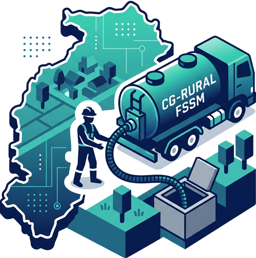
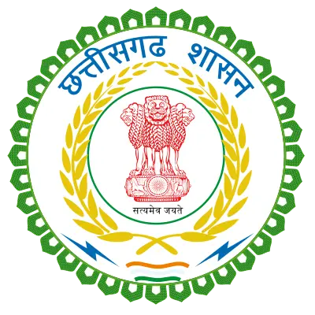
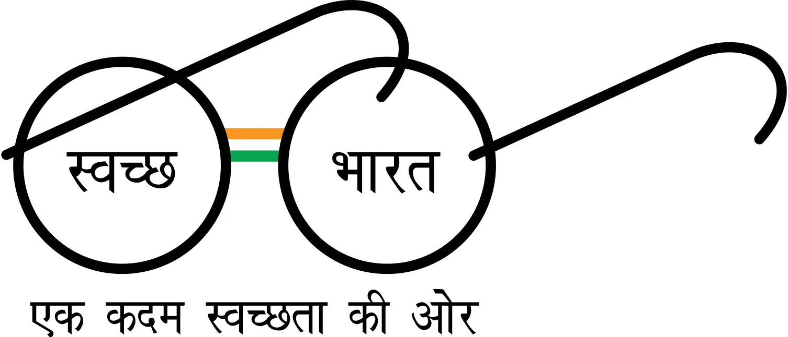
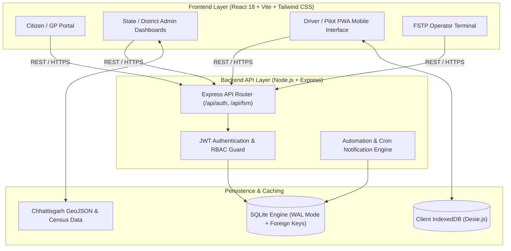

<div align="center">

# 🌿 CG Rural FSSM Platform
### **Faecal Sludge & Septage Management Information System**
#### *Government of Chhattisgarh &bull; UNICEF &bull; All India Institute of Local Self-Government (AIILSG)*

[](https://opensource.org/licenses/MIT)
[](https://nodejs.org/)
[](https://react.dev/)
[](https://vitejs.dev/)
[](https://tailwindcss.com/)
[](https://sqlite.org/)

<br />

<!-- Animated / Visual Branding Banner -->
<p align="center">
  
</p>

<!-- Animated Badges & Value Chain -->
<p align="center">
  <b>Safe Sanitation &bull; Scheduled Desludging &bull; Cluster FSTP Treatment &bull; Bio-Solids Reuse</b>
</p>

<p align="center">
  
</p>

---

<p align="center">
  
  &nbsp;&nbsp;&nbsp;&nbsp;&nbsp;&nbsp;&nbsp;&nbsp;&nbsp;&nbsp;
  
  &nbsp;&nbsp;&nbsp;&nbsp;&nbsp;&nbsp;&nbsp;&nbsp;&nbsp;&nbsp;
  
</p>

</div>

---

## 📖 Overview

The **Chhattisgarh Rural Faecal Sludge & Septage Management (FSSM) Platform** is an enterprise-grade digital public infrastructure designed to orchestrate and monitor safe sanitation chains across rural gram panchayats, blocks, and district clusters in Chhattisgarh.

Engineered under the aegis of the **Swachh Bharat Mission (Grameen)** in collaboration with **UNICEF** and **AIILSG**, the platform bridges citizens, vacuum tanker service operators, treatment plants (FSTPs), and multi-tier government administrations to ensure **100% safe desludging, transport, treatment, and resource recovery**.

---

## ✨ Key Capabilities

<table>
  <tr>
    <td width="50%">
      <h3 align="center">📱 Citizen & GP Frontends</h3>
      <ul>
        <li><b>Citizen Booking Portal:</b> Self-service desludging requests with instant cost estimation and SMS confirmations.</li>
        <li><b>Gram Panchayat & VLE Assistance:</b> Facilitated booking at CSCs for offline rural households.</li>
        <li><b>Bilingual UI:</b> Full English and Hindi support across workflows.</li>
        <li><b>Offline-First Resilience:</b> IndexedDB caching via Dexie.js for low-connectivity rural pockets.</li>
      </ul>
    </td>
    <td width="50%">
      <h3 align="center">🚛 Fleet & Plant Operations</h3>
      <ul>
        <li><b>Real-time Fleet Tracking:</b> TraqIndia GPS telemetry integration with live route mapping via Leaflet.</li>
        <li><b>Driver Digital Job Cards:</b> Turn-by-turn navigation, photo verification before/after desludging, and e-signatures.</li>
        <li><b>Cluster FSTP Logging:</b> Quality testing (BOD/COD/pH), volume measurement, and co-composting tracking.</li>
        <li><b>Emergency Spills & Alerts:</b> SOS incident escalation with geo-tagged photographic evidence.</li>
      </ul>
    </td>
  </tr>
  <tr>
    <td width="50%">
      <h3 align="center">📊 Governance & Multi-Tier Analytics</h3>
      <ul>
        <li><b>Role-Based Dashboards:</b> Super Admin, State, District, Block, GP, and Auditor dashboards.</li>
        <li><b>Dynamic GIS Visualizations:</b> GeoJSON boundary mapping with district-by-district performance chloropleths.</li>
        <li><b>SLA & Escalation Engine:</b> 48-hour turn-around SLA tracking with automated escalations.</li>
        <li><b>Audit Logs:</b> Tamper-evident logging of administrative actions, user logins, and billing records.</li>
      </ul>
    </td>
    <td width="50%">
      <h3 align="center">💳 Finance & Tariff Calculation</h3>
      <ul>
        <li><b>Distance-Based Dynamic Tariffs:</b> Automatic pricing engine factoring base rates, distance slabs, and volume.</li>
        <li><b>Subsidy Management:</b> BPL/Antyodaya household subsidy subsidies and DBT tracking.</li>
        <li><b>Multi-Format Exports:</b> Instant downloadable PDF work receipts (jsPDF) and Excel audit reports (xlsx).</li>
        <li><b>Secure Auth:</b> JWT tokens with bcryptjs hashing and fine-grained RBAC.</li>
      </ul>
    </td>
  </tr>
</table>

---

## 🏛️ System Architecture



---

## 🚀 Quick Start Guide

### 1. Prerequisites
* **Node.js**: `v18.x` or higher
* **npm**: `v9.x` or higher

### 2. Clone and Setup
```bash
# Clone the repository
git clone https://github.com/your-org/cg-rural-fssm.git
cd cg-rural-fssm

# Install dependencies for both frontend and backend
npm install
```

### 3. Environment Configuration
Verify or adjust `.env` file in the project root:
```env
PORT=5000
JWT_SECRET=cg_rural_fssm_jwt_super_secret_key_2026
JWT_EXPIRES_IN=7d
DB_PATH=./server/data/cgfssm.sqlite
NODE_ENV=development
```

### 4. Run the Application

#### ⚡ Run Frontend and Backend Together (Single Command)
```bash
npm run dev
```

#### 🛠️ Or Run Individually:
* **Backend Service:**
  ```bash
  npm run server
  # Listening on http://localhost:5000
  ```
* **Frontend Client:**
  ```bash
  npm run client
  # Accessible at http://localhost:5173
  ```

---

## 🔑 Pre-Seeded Demo Accounts

The platform auto-seeds standard users across administrative tiers on initial launch:

| Role | Username / Mobile / Email | Password | Scope |
| :--- | :--- | :--- | :--- |
| **Super Admin** | `9826100001` / `admin.fssm@cg.gov.in` | `Admin@2026` | State HQ, System Settings, Tariff Rates |
| **State Officer** | `9826100002` / `state.officer@cg.gov.in` | `Officer@2026` | State Director SBM-G, KPIs & Trends |
| **District Coordinator** | `9826100003` / `collector.raipur@cg.gov.in` | `Officer@2026` | Raipur District Collector Dashboard |
| **Block Coordinator** | `9826100004` / `sbm.dharsiwa@cg.gov.in` | `Officer@2026` | Dharsiwa Janpad Verification & Queue |
| **GP Operator / VLE** | `9826100005` / `sarpanch.mandirhasaud@cg.gov.in` | `Officer@2026` | Mandir Hasaud Gram Panchayat VLE Desk |
| **FSTP Operator** | `9826100006` / `fstp.arang@cg.gov.in` | `Officer@2026` | Arang Cluster FSTP Influx & Lab Tests |
| **Vendor Admin** | `9826100007` / `shiv@mahamayaclean.in` | `Officer@2026` | Shree Mahamaya Sanitation Fleet Dispatch |
| **Driver / Pilot** | `9826100008` / `driver.ramesh@cg.gov.in` | `Driver@2026` | Vehicle `CG-04-ME-4821` Job Card |
| **Citizen Beneficiary**| `9826100010` / `citizen.devendra@gmail.com` | `Citizen@2026` | Mandir Hasaud Citizen Portal |

---

## 🗂️ Project Directory Structure

```text
├── public/                 # Static assets, GeoJSON maps, and media
│   ├── logo/               # Gov logos, FSSM badges, animated GIFs & webm
│   ├── chhattisgarh.geojson# High-res boundary polygons for CG districts
│   └── locationData.json   # Hierarchical District -> Block -> GP directory
├── server/                 # Backend Node.js / Express Server
│   ├── data/               # SQLite database file persistence (cgfssm.sqlite)
│   ├── middleware/         # JWT verification, RBAC role guard
│   ├── routes/             # Authentication & FSM operational endpoints
│   ├── automation.js       # Background jobs, notifications & SLA checks
│   ├── db.js               # Database abstraction & table initialization
│   ├── index.js            # Express application entry point
│   └── seed.js             # Initial database seeder
├── src/                    # Frontend React 18 Application
│   ├── assets/             # Component-level SVGs and icons
│   ├── components/         # Reusable UI widgets, modals, charts, and tables
│   ├── context/            # AuthContext, LanguageContext, and GeoContext
│   ├── hooks/              # Custom React hooks (offline sync, geolocation)
│   ├── pages/              # Role-specific application views and portals
│   ├── App.jsx             # Main router and route definitions
│   └── main.jsx            # React root mount point
├── package.json            # Scripts and dependencies
└── vite.config.js          # Vite configuration
```

---

## 🤝 Partners & Governance

<div align="center">
  <p><b>Government of Chhattisgarh</b> &bull; Department of Panchayat & Rural Development</p>
  <p><b>UNICEF India</b> &bull; Water, Sanitation and Hygiene (WASH) Initiative</p>
  <p><b>All India Institute of Local Self-Government (AIILSG)</b></p>
  <p>Designed and developed by <b>Raj Yamagar</b> and supported by <b>United Nations Children's Fund (UNICEF) Chhattisgarh</b></p>
</div>

---

<div align="center">
  <sub>Built with ❤️ for a cleaner, healthier, and sustainable rural Chhattisgarh.</sub>
</div>
